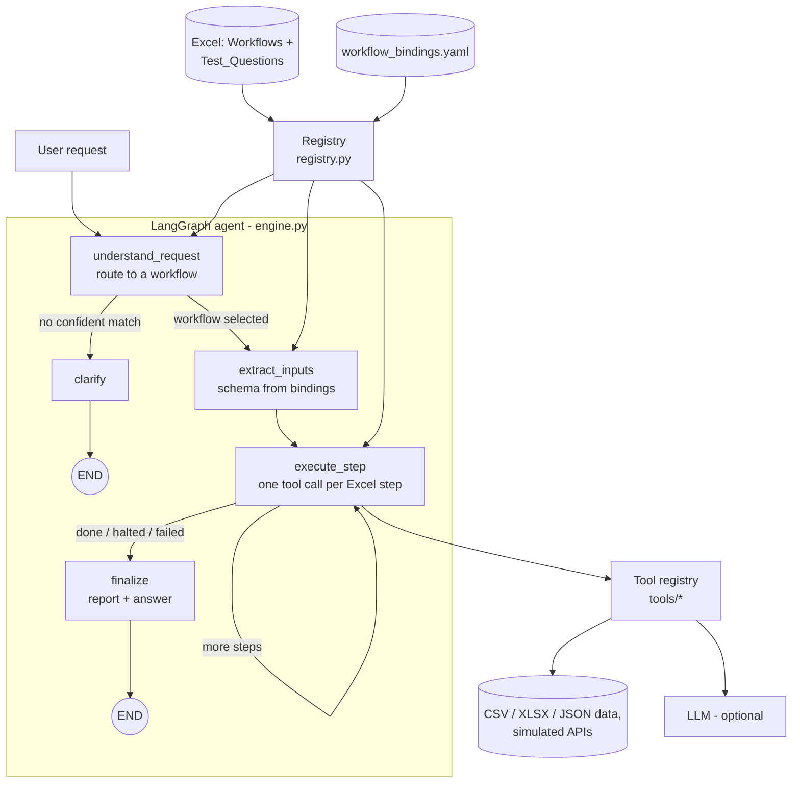

# AI Agent Workflow Automation

[](https://github.com/Aksharma127/Ai_automation_for_business/actions/workflows/ci.yml)


One reusable agent that reads business workflows from an **Excel file**, understands a user's
request, **selects the right workflow**, **executes its steps with tools**, applies the
workflow's **conditions and error handling**, and returns a traceable **final result**.

All 10 workflows in [`data/AI_Agent_Workflow_Assessment.xlsx`](data/AI_Agent_Workflow_Assessment.xlsx)
run through the same engine. There are no per-workflow chatbots: a workflow is a row in the
Excel file plus a declarative binding in [`config/workflow_bindings.yaml`](config/workflow_bindings.yaml).
Adding an 11th workflow needs no engine changes (see [Adding a workflow](#adding-an-11th-workflow)).

Built with **Python, LangGraph, LangChain tool calling** and any LLM supported by LangChain
(OpenAI, Anthropic, Groq, Ollama...). It also runs **fully offline without an API key**, using
deterministic routing and rule/template fallbacks, so it can be evaluated anywhere.

It can also be deployed as a service: an authenticated HTTP API with file uploads, runs that pause
for a missing detail and resume later (even after a restart), PostgreSQL run history, real HTTP
integrations behind the simulated ones, per-run LLM cost limits, Docker, and CI with a scored eval
set. See [Production deployment](#production-deployment).

```
User Request ─► Agent ─► Identify Workflow ─► Workflow Steps ─► Tools / APIs ─► Conditions / Decisions ─► Final Result
               (LangGraph)  (LLM tool call     (from Excel)      (tool registry,   (safe expressions,       (report + step trace)
                             or keyword index)                    simulated APIs)   halts, retries)
```

## Where to find each submission item

| Assignment requirement | Where it is |
|---|---|
| Source code | [`src/workflow_agent/`](src/workflow_agent/) |
| Excel workflow file | [`data/AI_Agent_Workflow_Assessment.xlsx`](data/AI_Agent_Workflow_Assessment.xlsx) |
| Setup and installation | [Quick start](#quick-start) |
| All 10 workflows (input, steps, tools, conditions, output) | [`docs/workflow_analysis.md`](docs/workflow_analysis.md), bound in [`config/workflow_bindings.yaml`](config/workflow_bindings.yaml) |
| Example inputs / requests | [`examples/requests.yaml`](examples/requests.yaml) (10 Excel test questions + 10 condition and error cases) |
| Outputs / results | [`outputs/`](outputs/) and the [results table](#results-for-all-10-workflows) below |
| Sample environment file | [`.env.example`](.env.example) |
| Architecture and agent flow | [Architecture](#architecture) |
| Adding an 11th workflow | [Adding an 11th workflow](#adding-an-11th-workflow) |
| Technical decisions | [Technical decisions](#technical-decisions) |
| Tests | [`tests/`](tests/) (`pytest`, 79 tests, no API key needed), run in [CI](.github/workflows/ci.yml) on every push |

---

## Quick start

```bash
git clone https://github.com/Aksharma127/Ai_automation_for_business.git
cd Ai_automation_for_business
python -m venv .venv && source .venv/bin/activate      # Windows: .venv\Scripts\activate
pip install -r requirements.txt
cp .env.example .env                                   # optional: add an API key for LLM mode

export PYTHONPATH=src                                  # Windows: set PYTHONPATH=src
python -m workflow_agent "Check today's inventory and identify products that need restocking."
```

(Or `pip install -e .` and use the `workflow-agent` command instead of `python -m workflow_agent`.)

Other commands:

| Command | What it does |
|---|---|
| `python -m workflow_agent "<request>"` | Run one request and print the selected workflow, executed steps and result |
| `python -m workflow_agent "<request>" --json` | Same, as JSON (full state: routing, inputs, trace, result) |
| `python -m workflow_agent -i` | Interactive chat loop (answers to follow-up questions continue the same run) |
| `python -m workflow_agent --reply RUN-... "ORD-1001"` | Answer a run that paused for a missing detail |
| `python -m workflow_agent "<request>" --file stock.csv` | Run a request on your own data file |
| `python -m workflow_agent --serve` | Start the HTTP API on port 8000 |
| `python -m workflow_agent --eval` | Score routing and input extraction on `evals/routing_extraction.yaml` |
| `python -m workflow_agent --list` | Show workflows loaded from the Excel file |
| `python -m workflow_agent --validate` | Check the Excel file and bindings are consistent |
| `python -m workflow_agent --run-examples` | Run every request in `examples/requests.yaml`, save results in `outputs/` |
| `python -m workflow_agent --docs` | Regenerate `docs/workflow_analysis.md` from the Excel + bindings |
| `python -m workflow_agent --offline ...` | Ignore any configured LLM |
| `pytest` | Run the test suite (79 tests, no API key needed) |

### Example

```
$ python -m workflow_agent "Which products need restocking?"

**Selected Workflow:** WF001 · Inventory Restock Check
**Routing:** keyword · confidence 0.801 · matched terms ['product', 'need', 'restock'] (evidence 14.19, runner-up 3.3)

**Steps Executed:**
1. ✓ Load inventory — `load_table` → loaded 10 products
2. ✓ compare current stock with minimum threshold — `add_columns` → compared stock with threshold for 10 products
3. ✓ identify low-stock products — `filter_rows` → 5 product(s) below threshold
4. ✓ calculate reorder quantity — `add_columns` → calculated reorder quantity for 5 product(s)
5. ✓ generate restock list — `sort_rows` → restock list with 5 product(s), lowest stock first

**Status:** Completed

**Result:**
5 of 10 products are below their minimum stock threshold. Estimated reorder cost: $2222.15.

| sku      | product_name                   | current_stock | threshold | suggested_reorder_qty | estimated_cost | supplier    |
| SKU-1005 | Wool Beanie Grey               | 0             | 15        | 30                    | 93.0           | KnitHouse   |
| SKU-1007 | Running Shoes Black Size 9     | 5             | 20        | 35                    | 980            | StrideMax   |
...
```

The step names come straight from the Excel `Steps` column.

---

## Results for all 10 workflows

[`outputs/`](outputs/) holds a saved run (Markdown and full JSON state) for each of the
Excel `Test_Questions` plus 10 extra requests that exercise conditions and failures.
[`outputs/README.md`](outputs/README.md) is the index.

| # | Request | Workflow | Outcome |
|---|---|---|---|
| 1 | Which products need restocking? | WF001 Inventory Restock Check | [5 products to restock with reorder qty](outputs/01_WF001_restock.md) |
| 2 | Find products where vendor price differs by more than 10%. | WF002 Product Price Validation | [4 exceptions, unmatched SKUs listed](outputs/02_WF002_price_validation.md) |
| 3 | Process this vendor spreadsheet and show invalid rows. | WF003 Vendor File Processing | [messy headers mapped, 2 invalid rows, cleaned CSV](outputs/03_WF003_vendor_file.md) |
| 4 | Generate SEO content for this product. | WF004 Product Description Generator | [4 content pieces; missing *material* flagged, not invented](outputs/04_WF004_seo_content.md) |
| 5 | Where is order ORD-1001? | WF005 Customer Order Status | [status + tracking, after a retried API timeout](outputs/05_WF005_order_status.md) |
| 6 | Find likely duplicate products in the catalog. | WF006 Duplicate Product Detection | [2 definite + 2 possible groups with confidence](outputs/06_WF006_duplicates.md) |
| 7 | Create a campaign brief for the new collection. | WF007 Marketing Campaign Brief | [asks for goal and dates first (Excel rule)](outputs/07_WF007_campaign_missing_info.md) |
| 8 | Classify these keywords and map them to pages. | WF008 SEO Keyword Classification | [intent, category, priority, target page; CSV export](outputs/08_WF008_keywords.md) |
| 9 | Assign this urgent task to the best available developer. | WF009 Employee Task Assignment | [Priya Nair, with reasoning and ranking](outputs/09_WF009_task_assignment.md) |
| 10 | Which workflows are failing most often? | WF010 Workflow Performance Report | [metrics, flags, top errors, slow steps, recommendations](outputs/10_WF010_performance.md) |

Conditions and errors, also saved in `outputs/`:

| Request | Behaviour |
|---|---|
| ...flag anything below 20 units | threshold override extracted from the request ([11](outputs/11_WF001_restock_custom_threshold.md)) |
| ...with a 5% tolerance | decision threshold changed by the request ([12](outputs/12_WF002_price_tolerance_5pct.md)) |
| Write product content for Merino Wool Scarf, category: ..., material: ... | attributes taken from the request ([13](outputs/13_WF004_seo_content_inline_product.md)) |
| Where is order ORD-9999? | not found, so it **asks for another identifier** (Excel rule) ([14](outputs/14_WF005_order_not_found.md)) |
| ...my email is jane.doe@example.com | lookup by email, 2 orders ([15](outputs/15_WF005_order_by_email.md)) |
| Track my order ORD-1004 | carrier API down: 3 attempts, then **degrades** to order-system status ([16](outputs/16_WF005_order_carrier_api_down.md)) |
| Where is my order? | no identifier, so it asks for one ([17](outputs/17_WF005_order_no_identifier.md)) |
| Campaign brief ... to drive online sales ... 2026-11-01 to 2026-11-30 | full brief ([18](outputs/18_WF007_campaign_complete.md)) |
| Assign ... Kubernetes with Terraform | no suitable developer, so it **escalates** (Excel rule) ([19](outputs/19_WF009_task_escalation.md)) |
| Book me a flight to Paris | no workflow fits, so it **asks to clarify** and lists what it can do ([20](outputs/20_none_out_of_scope.md)) |

The saved outputs were generated in offline mode so they are reproducible. With an API key,
routing, input extraction, intent/skill classification and content writing use the LLM.

---

## Architecture



| Layer | File | Responsibility |
|---|---|---|
| Workflow source | `data/AI_Agent_Workflow_Assessment.xlsx` | Name, trigger, inputs, steps, decision logic, tools, expected output, test questions |
| Bindings | `config/workflow_bindings.yaml` | Per workflow: input schema, the tool and arguments for each Excel step, result layout |
| Registry | `src/workflow_agent/registry.py` | Loads Excel + YAML, splits steps on `→`, validates step counts, tool names, arguments and Excel tool coverage |
| Router | `src/workflow_agent/router.py` | LLM tool call (`select_workflow`) or offline IDF-weighted keyword index; confidence threshold |
| Input extraction | `src/workflow_agent/extractor.py` | Builds a Pydantic model from the binding's input schema; LLM structured output or regex; defaults and type casting |
| Engine | `src/workflow_agent/engine.py` | LangGraph state machine, `$reference` resolution, retries, step timeouts, degrade/continue/fail policies, pause/resume, checkpoints |
| Run history | `src/workflow_agent/storage.py` | Every run and step in SQLite or PostgreSQL, with tokens, cost and duration |
| Integrations | `src/workflow_agent/integrations/` | Order and carrier services: HTTP clients when configured, file-backed simulation otherwise |
| HTTP API | `src/workflow_agent/api.py` | FastAPI: API keys, rate limits, uploads, run/reply/history endpoints |
| Tools | `src/workflow_agent/tools/` | 43 registered tools: generic data tools, validation, content generation, simulated APIs, domain analytics |
| Calculator | `src/workflow_agent/expressions.py` | Safe AST evaluator for business rules (`current_stock < threshold`), with no `eval` |
| Output | `src/workflow_agent/render.py`, `cli.py` | Selected workflow, steps executed and final result, as Markdown or JSON |

### How each evaluation criterion is handled

**Workflow selection.** With an LLM, the router sends every workflow's card (name, trigger,
expected output and example requests, all read from Excel) and must fill the
`select_workflow` schema with a workflow id, a confidence and its reasoning. Keyword
scores are passed as hints. Offline, an IDF-weighted index over the same Excel text
(the name and keywords weighted highest) scores each workflow; confidence combines how much
evidence was found with how clearly the best match beats the runner-up. Below
`MIN_ROUTE_CONFIDENCE` the agent asks the user to clarify instead of guessing.

**Agent reasoning.** The LLM is used where judgement is needed: picking the workflow,
extracting typed inputs from free text, classifying (campaign objective, keyword intent,
task skills, unknown file headers) and writing content. Deterministic tools do the
arithmetic and rule checks, where an LLM would be slower, costlier and less reliable. Every
decision is visible in the trace: the routing reasoning, the extracted inputs, and the rule
each step applied.

**Tool execution.** Tools are plain Python functions registered with `@tool(name, provides=...)`.
Bindings call them by name with arguments that may reference request inputs (`$inputs.x`)
or earlier outputs (`$low_stock`, `$joined.matched|count`). The registry checks at load time
that every tool exists, its arguments are valid and required ones are present. `provides`
labels are matched against the Excel `Tools_Required` column, and a warning is raised if a
workflow is missing a required capability.

**Conditions and decisions.** Each workflow's Decision_Logic is a visible rule in its binding:

| Workflow | Excel decision logic | Implemented as |
|---|---|---|
| WF001 | current_stock < minimum_stock → restock | `filter_rows` condition `current_stock < threshold` |
| WF002 | flag when difference > 10% | `filter_rows` condition `pct_diff > tolerance_pct` (10, or from the request) |
| WF003 | missing SKU or name → invalid | `validate_rows` `required: [sku, product_name]`, then `partition_rows` |
| WF004 | don't invent missing attributes; mark missing | `collect_fields` lists missing fields; `generate_content` rejects LLM text that names a value for a missing field (`guard_terms`) and falls back to the template |
| WF005 | no order found → ask for another identifier | `find_records` raises `NeedsInput` and the run ends with a question |
| WF006 | exact SKU = definite; high similarity = possible | `find_exact_duplicates` + `similar_pairs` + `assign_confidence` |
| WF007 | goal or dates missing → request them first | `collect_fields required: [goal, start_date, end_date]`, plus a date-order check |
| WF008 | 4 search intents | `classify_intent` (LLM or cue rules) |
| WF009 | prefer skills + capacity; escalate if none | `rank_rows` score, then `select_best eligible_if: skill_match >= 0.5 and has_capacity`, which raises `Escalate` |
| WF010 | failure rate > 10% or avg time > threshold | `performance_recommendations flag_if: failure_rate > 0.10 or avg_duration_sec > 30` |

**Error handling.**
- *Business halts* are outcomes, not crashes: `NeedsInput` (ask the user), `Escalate`
  (hand to a human). The run ends with status `needs_input` / `escalated` and a clear message.
- *Transient failures* (`TransientToolError`, such as the simulated carrier API timeout) are
  retried with exponential backoff (`retries: 2`). If they still fail,
  `on_error: degrade` switches to a `fallback_tool`, and the user sees a partial
  result with a note.
- *Bad data* in a single row (text where a number is expected, negative quantity) is
  cleared and reported as a warning without stopping the workflow.
- *Hard failures* (missing file, bad reference) stop the run with status `failed` and a
  readable message naming the step. No stack traces reach the user.
- *LLM failures* never break a run: every LLM call has a deterministic fallback, and the
  fallback is recorded in the notes.
- *Config errors* are caught at startup by `--validate`: a binding out of sync with the Excel
  row, an unknown tool, or a wrong argument.

**Reusability, scalability, maintainability.**
- The engine, router, extractor and renderer contain no workflow-specific code.
- About 70% of steps (40 of 56) use generic tools (`load_table`, `add_columns`, `filter_rows`,
  `join_tables`, `rank_rows`, `select_best`, `collect_fields`, `generate_content`,
  `export_table`...). Domain tools exist only where the logic is genuinely specific, such as
  duplicate clustering or log analytics.
- Business parameters (thresholds, weights, synonyms, channel rules, page templates, intent
  cues) live in YAML, not code.
- `docs/workflow_analysis.md` is generated from the registry, so documentation cannot drift.
- Every run and step is stored in the run history database, and WF010 can read it in the same
  format as its sample log, so the agent can report on its own performance:
  `python -m workflow_agent "Which workflows fail most in our own run history?"`.

---

## The 10 workflows

[`docs/workflow_analysis.md`](docs/workflow_analysis.md) breaks down every workflow:
input, steps, tools/APIs, conditions and expected output, plus the tool and rule behind each
Excel step. Summary:

| ID | Workflow | Input (sample data) | Tools used | Output |
|---|---|---|---|---|
| WF001 | Inventory Restock Check | `inventory.csv` | load_table, add_columns (calculator), filter_rows, sort_rows | restock list with threshold and reorder qty |
| WF002 | Product Price Validation | `products.csv`, `vendor_prices.csv` | load_tables, join_tables, add_columns, filter_rows | matched, differences, exceptions, unmatched |
| WF003 | Vendor File Processing | `vendor_upload.xlsx` (messy headers, bad rows) | load_table, detect_columns (+LLM), rename_columns, validate_rows, partition_rows, export_tables | cleaned CSV, invalid-row CSV, summary |
| WF004 | Product Description Generator | `product_input.json` or the request | collect_fields, generate_content x4 (LLM + grounded template) | description, short description, SEO title (≤60), meta (≤160), missing info |
| WF005 | Customer Order Status | `orders.json` DB, `shipments.json` carrier API (simulated) | validate_identifier, find_records, pick_fields, shipment_lookup (retry, degrade), summarize_orders | status, items, shipment, tracking |
| WF006 | Duplicate Product Detection | `catalog.csv` | normalize_fields, find_exact_duplicates, similar_pairs, group_duplicates, assign_confidence | duplicate groups with matching fields and confidence |
| WF007 | Marketing Campaign Brief | request + `products.csv` | collect_fields, classify_text, query_table, generate_content, lookup_rules, build_timeline | objective, audience, products, messaging, channels, dated checklist |
| WF008 | SEO Keyword Classification | `keywords.csv` | load_table, dedupe_rows, classify_intent (+LLM), map_categories, rank_rows, export_table | intent, category, priority, target page; CSV |
| WF009 | Employee Task Assignment | `employees.csv`, `pending_task.json` or the request | understand_task (+LLM), score_skill_match, check_workload, rank_rows, select_best, generate_content | employee, reasoning, priority, deadline, alternatives |
| WF010 | Workflow Performance Report | `execution_logs.csv` (or the agent's own run history) | load_table, run_outcomes, run_durations, frequent_errors, slow_steps, performance_recommendations | metrics, flags, errors, slow steps, recommendations |

Simulated systems: where real APIs are unavailable, data lives in `data/sample/`. The order
database is `orders.json`. The carrier tracking API is `shipments.json`, where one tracking
number is configured to time out once (to show retries) and one carrier is always down (to
show degradation). `scripts/make_sample_data.py` regenerates the generated files.

---

## Adding an 11th workflow

1. **Add a row** to the `Workflows` sheet of the Excel file (optionally add a test question to `Test_Questions`):

   | Workflow_ID | Workflow_Name | Trigger | Inputs | Steps | Decision_Logic | Tools_Required | Expected_Output |
   |---|---|---|---|---|---|---|---|
   | WF011 | Low Margin Alert | User asks which products have a low margin | Product CSV; vendor price list | Load prices → match products by SKU → calculate margin → flag low-margin products | Flag when margin is below 30% | CSV reader; calculator | Products with margin below the minimum |

2. **Add a binding** in `config/workflow_bindings.yaml`, one entry per Excel step:

   ```yaml
   WF011:
     keywords: [margin, low margin, profitability]
     inputs:
       min_margin: {type: number, default: 30, pattern: '(\d+)\s*%'}
     steps:
       - tool: load_tables
         args: {sources: {p: data/sample/products.csv, v: data/sample/vendor_prices.csv}}
         save_as: data
       - tool: join_tables
         args: {left: $data.p, right: $data.v, left_on: sku, right_on: vendor_sku}
         save_as: joined
       - tool: add_columns
         args: {table: $joined.matched, columns: {margin_pct: 'round((our_price - vendor_price) * 100 / our_price, 1)'}}
         save_as: with_margin
       - tool: filter_rows
         args: {table: $with_margin, condition: 'margin_pct < min_margin', params: {min_margin: $inputs.min_margin}}
         save_as: low
     report:
       title: Low margin products
       summary: '{n} product(s) below {m}% margin'
       values: {n: $low|count, m: $inputs.min_margin}
       sections: [{heading: Products, table: $low, columns: [sku, product_name, margin_pct]}]
   ```

3. Run `python -m workflow_agent --validate`. That's it: the router, input extractor, engine,
   trace and output pick it up automatically. `tests/test_registry.py::test_eleventh_workflow_is_data_only`
   does exactly this against a copy of the Excel file and runs the new workflow end to end.

Only if no existing tool fits do you write a new one: a function decorated with
`@tool("name", provides=("capability",))` in `src/workflow_agent/tools/`.

---

## Production deployment

Everything below is optional: with no extra configuration the project still runs locally, offline,
on SQLite and the simulated services. All settings are documented in [`.env.example`](.env.example).

<details>
<summary><b>Show deployment details</b>: Docker, HTTP API, resumable runs, real integrations, safety limits, observability, CI and evals</summary>

### Run it

```bash
cp .env.example .env            # set API_KEYS, and an LLM key if you want LLM mode
docker compose up --build       # API on :8000 + PostgreSQL
```

Or without Docker: `pip install -e ".[api,postgres,anthropic]"` then `python -m workflow_agent --serve`.
With `APP_ENV=production` the service refuses to start without `API_KEYS` (or `AUTH_DISABLED=1`
behind a trusted gateway) and without a PostgreSQL `DATABASE_URL`.

### HTTP API

Every `/v1` call needs `X-API-Key: <key>` or `Authorization: Bearer <key>`. Interactive docs are at `/docs`.

| Method and path | What it does |
|---|---|
| `GET /healthz`, `GET /readyz` | Liveness; readiness (registry loaded, database reachable) |
| `GET /v1/workflows` | Workflows loaded from the Excel file, and which accept an uploaded file |
| `POST /v1/runs` `{"request": "..."}` | Run a request. The response has the workflow, inputs, steps, result, usage and a Markdown report |
| `POST /v1/runs/upload` (multipart `request`, `file`) | Same, using an uploaded CSV, XLSX or JSON file as the workflow's data |
| `POST /v1/runs/{run_id}/reply` `{"answer": "..."}` | Continue a run that is `awaiting_reply` |
| `GET /v1/runs/{run_id}`, `GET /v1/runs` | Stored run with its steps; recent runs (`?status=&limit=`) |

```bash
curl -s localhost:8000/v1/runs -H "X-API-Key: $KEY" -H "content-type: application/json" \
     -d '{"request": "Where is my order?"}'
# -> {"run_id": "RUN-...", "status": "needs_input", "awaiting_reply": true,
#     "question": "Please provide an order ID (e.g. ORD-1001) or the customer email used for the order.", ...}
curl -s localhost:8000/v1/runs/RUN-.../reply -H "X-API-Key: $KEY" -H "content-type: application/json" \
     -d '{"answer": "It is ORD-1001"}'
# -> {"status": "completed", "workflow": {"id": "WF005", ...}, "steps": [...], ...}
```

Runs belong to the API key that started them: another key gets a 404.

### Resumable runs

When a workflow needs something only the user can give (an order ID, a campaign goal), the run
pauses with LangGraph's `interrupt()` and its state is checkpointed. The reply is merged into the
inputs and the workflow continues from the start with the new information. Checkpoints live in
PostgreSQL (or `runs/agent.checkpoints.db` locally), so a paused run survives a restart or can be
answered by a different replica. Requests that match no workflow pause too, and the reply is routed again.

### Real integrations

Set `ORDERS_API_URL` / `CARRIER_API_URL` (and optional bearer tokens) to switch WF005 from the
simulated files to HTTP services. The tools and bindings do not change. Expected contract:

| Call | Response |
|---|---|
| `GET {ORDERS_API_URL}/orders?order_id=ORD-1001` or `?customer_email=...` | `{"orders": [{"order_id", "customer_email", "status", "order_date", "items": [{"sku", "name", "qty"}], "tracking_number", "carrier"}]}` (a bare list also works) |
| `GET {CARRIER_API_URL}/track/{tracking_number}` | `{"status", "last_location", "last_update", "estimated_delivery"}`, or 404 if unknown |

Timeouts, 429 and 5xx responses count as transient: the step retries with backoff, then degrades
to order-system status only. Other 4xx responses fail the step with a readable message. Data files
can also come from `https://` URLs on hosts listed in `ALLOWED_SOURCE_HOSTS`.

### Safety and limits

- **Auth and rate limits:** API keys compared in constant time, and a per-key requests-per-minute limit (`RATE_LIMIT_PER_MINUTE`).
- **Uploads:** extension allowlist (.csv, .xlsx, .json), size cap (`MAX_UPLOAD_MB`), UTF-8 check, and zip-bomb check for .xlsx. Files are stored under a random name.
- **File sandbox:** tools can only read files under `ALLOWED_DATA_DIRS` (default `data`, `runs`, `outputs`), so a request cannot read `/etc/passwd` or `.env`.
- **Prompt injection:** user text and file contents go to the model inside `<data>` tags, with an instruction to treat them as data. Decisions are made by the workflow's rules, not by the model.
- **LLM cost and rate:** request timeout, client retries, a client-side rate limiter, and a per-run budget (`MAX_LLM_CALLS_PER_RUN`, `MAX_LLM_COST_PER_RUN_USD`). When the budget runs out the step falls back to its deterministic path.
- **Step timeouts:** each tool call is limited to `STEP_TIMEOUT_SEC`. Request length is capped by `MAX_REQUEST_CHARS`.

### Observability

- Structured logs (`LOG_JSON=1`) with a request ID and run ID on every line.
- Each run and step is stored in the run history with status, attempts, duration, LLM calls, tokens and estimated cost. Prices are in `llm.PRICES` or `LLM_PRICE_*_PER_MTOK`.
- OpenTelemetry spans for runs and steps when `.[otel]` is installed; export with the standard `OTEL_*` variables.

### CI and evals

[`.github/workflows/ci.yml`](.github/workflows/ci.yml) runs on every push and PR:

- ruff and mypy
- the test suite, including the PostgreSQL resume test
- `--validate`
- every example request, checked for the right workflow
- the offline eval
- a Docker build with a smoke test

[`evals/routing_extraction.yaml`](evals/routing_extraction.yaml) has 42 labelled requests: paraphrases,
stated inputs, and out-of-scope requests. `python -m workflow_agent --eval` scores routing accuracy
and input accuracy and fails below the thresholds in the file. With an `ANTHROPIC_API_KEY` repository
secret, CI also runs the eval against a real model (`--eval --llm`, model `vars.EVAL_LLM_MODEL`,
default `claude-haiku-5-5`).

</details>

---

## Technical decisions

| Decision | Why |
|---|---|
| **LangGraph** state machine | Explicit, inspectable control flow (route → extract → step loop → finalize) with conditional edges for halts. The state is a typed dict, so each run's full trace is serialisable and saved as JSON. Graph nodes are generic; the graph never changes when workflows are added. |
| **Declarative step bindings** instead of a free-roaming ReAct agent | The Excel defines the *required* steps and the rules. Executing them as a plan makes every run follow the business process, keeps decision logic auditable and reproducible, and makes it cheap (one LLM call to route, not one per step). The LLM is used where it adds value: understanding the request, extracting inputs, classifying and writing. |
| **Excel stays the source of truth** | Business users edit the workflow (name, trigger, steps, examples) in Excel. The loader validates that the YAML binding still matches the Excel step count, and that the bound tools cover the Excel `Tools_Required`. |
| **Tool calling / structured output for routing and extraction** | `select_workflow` and the per-workflow input schema are Pydantic models bound to the model (`with_structured_output`), so the LLM returns validated, typed data instead of free text to parse. OpenAI-style providers use function calling; current Claude models don't allow forcing a tool, so for Anthropic the same schemas go through native structured outputs (`llm.structured()`). |
| **Provider-agnostic LLM** (`init_chat_model`) | Swap OpenAI, Anthropic, Groq or a local Ollama model by changing `.env`. Defaults: `gpt-4o-mini` for OpenAI, `claude-opus-5-5` for Anthropic (`LLM_MODEL` overrides). |
| **Offline fallback for every LLM step** | The system is fully testable and demonstrable without a key, and degrades gracefully if the provider fails mid-run. |
| **Safe expression language** for rules | Business rules stay readable in config (`current_stock < threshold`) without `eval`. Only arithmetic, comparisons, boolean logic, indexing and whitelisted functions are allowed. |
| **Halts as typed exceptions** (`NeedsInput`, `Escalate`) | "Ask the user" and "escalate" are first-class outcomes, distinct from failures, as the Excel decision logic requires. |
| **Simulated APIs with failure modes** | Shows retry, backoff and degradation on realistic failures without external dependencies. |

### Limitations and next steps

- Offline routing is lexical: unusual phrasings with no workflow vocabulary ("who should take the payments bug?")
  may need the LLM router. Adding `keywords`/examples in the binding fixes specific cases.
- Offline date extraction expects ISO dates (`2026-11-01`). The LLM extractor handles natural dates.
- The API rate limiter is per process. With several replicas, rate-limit at the gateway as well.
- The HTTP integrations follow the generic contract in [Real integrations](#real-integrations). A specific vendor (Shopify, UPS, ...)
  needs its field mapping adjusted in `integrations/services.py`.

---

## Project layout

```
├── data/
│   ├── AI_Agent_Workflow_Assessment.xlsx   # workflow source (Workflows + Test_Questions sheets)
│   └── sample/                             # simulated data sources and APIs
├── config/workflow_bindings.yaml           # how each Excel step is executed
├── src/workflow_agent/
│   ├── engine.py        # LangGraph agent
│   ├── registry.py      # Excel + YAML loader and validator
│   ├── router.py        # LLM tool-call router + offline keyword router
│   ├── extractor.py     # request → typed workflow inputs
│   ├── expressions.py   # safe calculator for rules
│   ├── llm.py           # provider-agnostic LLM access, per-run budget
│   ├── api.py           # HTTP API (FastAPI)
│   ├── storage.py       # run history (SQLite / PostgreSQL)
│   ├── integrations/    # order + carrier services (HTTP or simulated)
│   ├── observability.py # logging, tracing
│   ├── evals.py         # routing / extraction scoring
│   ├── render.py, cli.py
│   └── tools/           # tool registry + tools (data, records, content, services, catalog, seo, people, ops)
├── examples/requests.yaml   # 10 Excel test questions + 10 condition/error cases
├── outputs/                 # saved results for every example (Markdown + JSON) and generated files
├── evals/routing_extraction.yaml  # scored test set
├── docs/workflow_analysis.md
├── scripts/make_sample_data.py
├── tests/                   # 79 tests: routing, every workflow, conditions, errors, LLM path, 11th workflow, API, resume, integrations
├── Dockerfile, docker-compose.yml, .github/workflows/ci.yml
├── .env.example, requirements.txt, pyproject.toml
```
